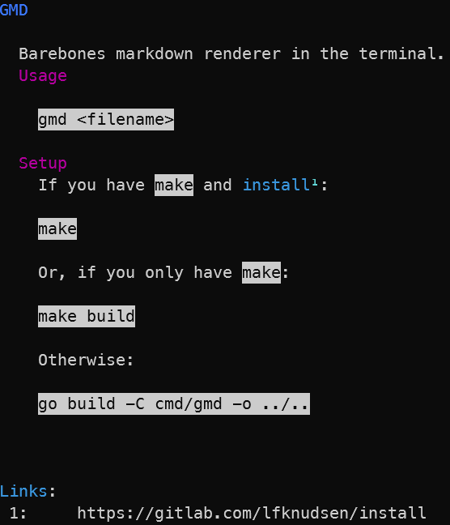

# GMD

Barebones markdown renderer in the terminal.

## Usage

```
gmd <filename>
```

## Setup

If you have `make` and [install](https://gitlab.com/lfknudsen/install):

```
make
```

Or, if you only have `make`:

```
make build
```

Otherwise:

```
go build -C cmd/gmd -o ../..
```

## Example:

